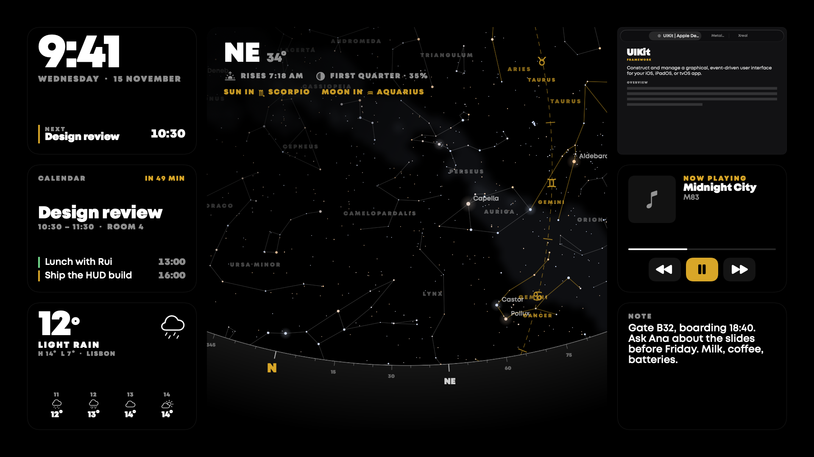
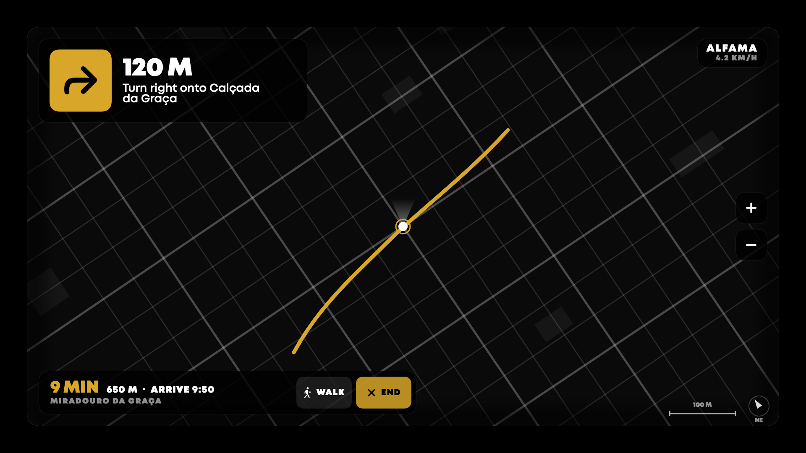
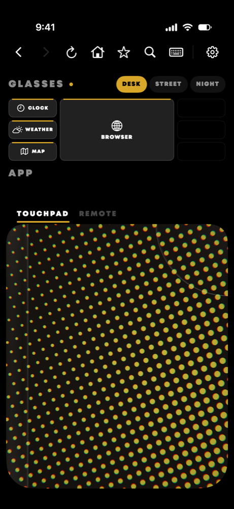
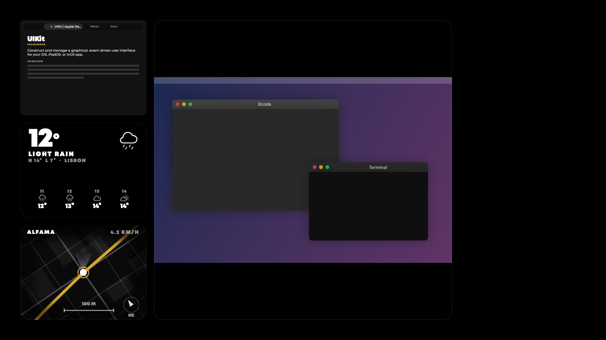

# TheHud

A heads-up display for Xreal glasses, run from your phone. Plug the glasses into an iPhone and
they become a screen of apps. These include a browser, your Mac, YouTube, maps, the night sky,
music, calendar, photos, live captions and more. The phone becomes the trackpad and keyboard
that work them.



The glasses take DisplayPort over USB-C and show a 1920×1080 picture. They're a display, not a
computer, so everything on them is drawn by this app.

There is an iOS app (the main one), an Android app that does the same on Android phones, and
HudCast, a small Mac menu bar app that streams the Mac to the glasses.

## What's on the glasses

The glasses show one app in the centre, with up to three widgets down each side. Every app has
three sizes:

- **Widget**: small, in a side slot.
- **Centre**: the big space in the middle, where you do your multitasking.
- **Fullscreen**: the whole display.

| App | What it does |
|---|---|
| Browser | Tabs, a start page, real sign-ins, video fullscreen |
| Mac | Your Mac's screen, streamed live by HudCast, with its windows listed on the phone |
| YouTube | Browse, search from the phone, a queue, a player that keeps going in a widget |
| Map | Live position and heading, search, and walking or driving directions |
| Sky | Stars, constellations, planets, the Moon's phase, and the planes and ISS overhead |
| Music | What's playing, with its controls |
| Calendar | Today's agenda and the month |
| Photos | The photo library, newest first, as a gallery or slideshow |
| Teleprompter | Your text scrolling at a pace you set from the phone |
| Note | A note typed on the phone |
| Weather | Now, the next days, air quality, UV and pollen |
| Clock | Time, date, the next event, and a timer |
| Activity | Steps, distance and floors today |
| Captions | Live captions of what's said around you, transcribed on the phone and saved |



## The phone



The top of the phone shows a miniature of the glasses:

- Drag an app from the APP list into any slot.
- Tap a widget to turn it off.
- Hold a widget to show it fullscreen, and tap again to come back.

Scenes (DESK, STREET, NIGHT) keep a whole arrangement each, so you can switch between them in one
tap.

The rest of the phone is the input:

- **Touchpad**: works like a Mac trackpad. Tap to click, two fingers to scroll or right-click,
  double tap and drag, with momentum. The rail on the left edge scrolls.
- **Remote**: point the phone like an air mouse. The gyroscope moves the cursor.
- **Keyboard**: the system keyboard types into whatever has focus on the glasses.
- **App pads**: controls for the app in the centre, such as YouTube search, music controls,
  teleprompter speed and photo stepping.

The cursor hides after a minute untouched, or when the phone locks.

Settings has a theme colour: Mustard, Lime, Mint, Sky, Iris, Orchid, Rose or Coral. It colours
every accent on the glasses and the phone, the touchpad, and the app icon. Each colour is the
mustard turned round the colour wheel at the same lightness, so all of them read the same on the
dark app. The paired Android phone takes the iPhone's colour.

<br clear="right">

## The Mac



HudCast runs in the Mac's menu bar. It finds the phone on the local network, streams the screen as
H.264, and takes the phone's clicks and typing. It needs Screen Recording and Accessibility
permissions the first time.

Its menu has:

- **Start Sharing / Stop Sharing**: stopping hides HudCast from the phone and drops any phone
  connected to it.
- **Mirror**: the glasses show the Mac's main screen.
- **Extend**: the glasses get a 1920×1080 screen of their own, placed directly above the main
  one, so you move the pointer up to reach it. macOS treats it like a real monitor. It's plugged
  in while a phone is connected, and its windows come back to the Mac when the phone goes.

```bash
scripts/build-hudcast.sh
```

This builds `dist/HudCast.app`, signed ad hoc. The first time you open it, right-click it and
choose Open.

## Two phones: Remote Connect and Host mode

The iPhone can work an Android phone's glasses. To pair them:

1. Hold the settings button on the Android phone. It shows a QR code.
2. Hold the settings button on the iPhone and scan the code.

Both phones need to be on the same network. There are two modes, picked when you pair:

- **Remote**: the Android phone runs the apps and drives the glasses. The iPhone is its full remote,
  with the miniature, scenes, APP picker, touchpad, Remote pointing, keyboard and app pads, so it
  feels like using the iPhone app directly.
- **Host**: the iPhone runs the apps. The Android phone only shows them, streamed from the iPhone at
  up to 60 fps:
  - The Android phone plays the YouTube video itself, in sync, so the sound comes out of the
    glasses.
  - "Sound on this iPhone" in Settings plays it on the iPhone instead, for headphones.
  - Playback carries on with the iPhone locked.

## Android

The Android app has the same apps, the same arrangement and the same phone controls. It was built
around the Galaxy Z Flip, whose cover screen works as the touchpad with the phone closed. It needs
Android 12 or later.

Some apps use different data sources on Android:

- The map uses OpenStreetMap tiles, Photon search and OSRM routing.
- An accessibility service keeps the glasses above DeX's taskbar.

## What you need

- **iPhone:** an iPhone 15 or later with a USB-C port that carries DisplayPort. The 16e and the
  iPhone Air don't. You also need a cable that carries video; the one in the phone's box doesn't.
  iOS 17 or later.
- **Android:** a phone whose USB-C port carries DisplayPort, running Android 12 or later.
- **Glasses:** Xreal glasses, or any glasses that take DisplayPort over USB-C.

## Installing

Every push builds both apps in GitHub Actions. Download them from the latest run:

```bash
gh run download --name TheHud-unsigned-ipa
```

```bash
gh run download --name TheHud-android-apk
```

The iPhone build is unsigned. To install it, sign it with Sideloadly or AltStore:

- **Free Apple ID:** the install lasts seven days and then has to be refreshed.
- **Paid developer account:** it lasts a year.

With Xcode, you can also build and run it directly. Generate the project:

```bash
brew install xcodegen && xcodegen
```

Then open `TheHud.xcodeproj`, set your team, and run.

## Building and checking

The engine, all the screens and the tests build with just the Command Line Tools. You don't need
Xcode.

```bash
swift run hudtests
```

The input engine takes abstract touch frames rather than `UITouch`. So the gesture recogniser,
pointer filtering, acceleration, momentum, layouts, page scripts, YouTube parsing, the sky and the
Remote Connect wire all run on the Mac, with no device and no simulator.

```bash
swift run hudshot --out out
```

This renders every glasses and phone screen to PNG through the app's own SwiftUI views and Metal
renderer. It's how the pictures in this README were made. Add `--live` for real weather and maps,
taken for a fixed Lisbon coordinate. Without `--live`, nothing leaves the machine.

For Android:

```bash
cd android && ./gradlew assembleDebug testDebugUnitTest recordRoborazziDebug
```

This builds the app, runs the tests, and renders the Android screens with Roborazzi.

CI runs all of this on every push. It attaches the IPA, the APK and both sets of pictures to the
run.

### Layout

| Path | What's in it |
|---|---|
| `Sources/HudCore` | The engine and every screen, shared by the iOS app and the tools |
| `App/TheHud` | The iOS app: the phone scene, the glasses scene, Host mode streaming |
| `android` | The Android app (Kotlin, Jetpack Compose) |
| `Sources/hudcast` | HudCast, the Mac side of the Mac app |
| `Sources/hudshot` | The screen renderer |
| `Sources/hudtests` | The tests |

## Where the data comes from

| Data | Source | Notes |
|---|---|---|
| Weather, air quality | Open-Meteo | No account or key. Coordinates are rounded before they're sent |
| Map, search, directions | MapKit (iOS), OpenStreetMap (Android) | |
| Planes overhead | adsb.lol | |
| ISS | wheretheiss.at | |
| Sky | Astronomy Engine and the d3-celestial catalogue | Computed on the phone |
| Calendar, photos, music, steps | The phone's own APIs | Each asks for permission once |
| Captions | On-device speech recognition | Nothing leaves the phone |

Each app degrades on its own. If one doesn't get permission or network, it shows less, and the rest
of the HUD carries on.

## Credits

- [Astronomy Engine](https://github.com/cosinekitty/astronomy) by Don Cross, MIT licence
  (`Sources/CAstronomy`).
- The star and constellation data comes from
  [d3-celestial](https://github.com/ofrohn/d3-celestial) by Olaf Frohn, BSD licence.
- The typeface is Mont, a commercial font. Its licence isn't covered by this repository.
